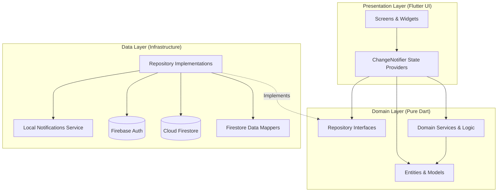

# Architecture Spine — Credit Bill System

## Design Paradigm

The application adopts a **Layered Feature-Driven Architecture** adhering to Clean Architecture principles. Features are isolated as independent vertical slices (`auth`, `cards`, `bills`, `payments`, `calendar`), each containing three horizontal layers:

1. **Presentation Layer**: Flutter widgets, screens, and `ChangeNotifier` state controllers. Observes state and dispatches user actions. Depends *only* on the Domain layer.
2. **Domain Layer**: Pure Dart entities, value objects, and business calculation logic (e.g., credit utilization formula, bill lifecycle evaluation). Free of Flutter UI framework or Firebase SDK dependencies.
3. **Data Layer**: Repositories, data models (with Firestore serialization `toMap`/`fromMap`), and remote/local data sources. Implements Domain repository contracts and communicates with Firebase and system services.



---

## Invariants & Rules

### AD-1 — Layer Isolation & Dependency Inversion [ADOPTED]
* **Binds**: All feature modules (`lib/features/*`)
* **Prevents**: UI widgets directly importing Cloud Firestore SDKs or performing database reads inside `build()` methods.
* **Rule**: The Presentation layer must interact with data strictly through abstract repository interfaces defined in the Domain layer. No widget may invoke `FirebaseFirestore.instance` directly.

### AD-2 — User-Scoped Firestore Data Isolation [ADOPTED]
* **Binds**: FR-1, FR-4, FR-9, FR-12, NFR-1, NFR-2
* **Prevents**: Cross-user data leakage and multi-tenant security vulnerabilities.
* **Rule**: All persistent business entities must reside within the authenticated user's root subcollections:
  `/users/{userId}/cards/{cardId}`, `/users/{userId}/bills/{billId}`, `/users/{userId}/payments/{paymentId}`.
  Firestore security rules must mandate `request.auth != null && request.auth.uid == userId` for all read and write operations.

### AD-3 — Domain-Owned Mathematical Invariants [ADOPTED]
* **Binds**: FR-7, FR-8, FR-10, FR-13
* **Prevents**: Discrepancies between screen calculation results, inconsistent bill status states, and negative remaining balances.
* **Rule**: Credit utilization percentages and bill lifecycle status progressions must be evaluated exclusively via pure, static Domain functions (`CreditCalculator.calculateUtilization` and `BillStatusEvaluator.evaluate`). Calculations must never be duplicated inside UI widgets.

### AD-4 — State Mutation via Provider ChangeNotifier [ADOPTED]
* **Binds**: All stateful screens and widgets
* **Prevents**: Uncontrolled widget rebuild cascades, scattered `setState()` synchronization bugs, and stale cache displays.
* **Rule**: Global and feature-level state mutations must be managed via Provider `ChangeNotifier` classes (`AuthProvider`, `CardProvider`, `BillProvider`, `PaymentProvider`). Widgets consume state via `context.watch<T>()` or `Consumer<T>`, and trigger mutations via `context.read<T>().action()`.

### AD-5 — Deterministic Notification ID Mapping [ADOPTED]
* **Binds**: FR-16, FR-17, NFR-4
* **Prevents**: Ghost notifications after bill payments, notification ID collisions, and orphaned background alarms.
* **Rule**: Local notification IDs must be generated deterministically from the bill ID hash:
  `Reminder-3-Days = (billId.hashCode & 0x7FFFFFFF) * 10 + 1`
  `Reminder-1-Day = (billId.hashCode & 0x7FFFFFFF) * 10 + 2`
  `Reminder-Due-Date = (billId.hashCode & 0x7FFFFFFF) * 10 + 3`
  When a bill’s status becomes `paid`, all three IDs must be explicitly cancelled via `flutter_local_notifications`.

### AD-6 — Card Data Masking & Zero-PCI Scope [ADOPTED]
* **Binds**: FR-4, FR-5, NFR-1
* **Prevents**: Inadvertent collection or storage of sensitive cardholder data (PAN, CVV, PIN, expiration date).
* **Rule**: The data schema and UI forms must only capture the bank name, user nickname, and the **last 4 digits**. 16-digit card numbers, CVVs, and magnetic stripe data must never be collected, transmitted, or logged.

### AD-7 — Offline-First Persistence Contract [ADOPTED]
* **Binds**: NFR-3, NFR-5
* **Prevents**: App lockouts, blank screens, and crashing when devices lose cellular or Wi-Fi connectivity.
* **Rule**: Cloud Firestore offline caching must be enabled during app initialization:
  `FirebaseFirestore.instance.settings = const Settings(persistenceEnabled: true);`.
  UI controllers must read from Firestore stream subscriptions that deliver cached snapshots immediately, updating smoothly when remote sync completes.

### AD-8 — Standardized Application Failure Envelope [ADOPTED]
* **Binds**: All repositories and controllers
* **Prevents**: Unhandled asynchronous exceptions causing Flutter grey error screens or silent background failures.
* **Rule**: Repositories must catch platform and network exceptions and rethrow typed domain exceptions (`AppException` subclasses: `AuthException`, `DatabaseException`, `ValidationException`). Controllers must catch these exceptions, update a user-facing `errorMessage` property, and present them via `ScaffoldMessenger.showSnackBar()`.

---

## Consistency Conventions

| Concern | Convention |
| :--- | :--- |
| **File Naming** | Lowercase snake_case: `card_model.dart`, `card_repository.dart`, `card_provider.dart`, `card_screen.dart`. |
| **Class Naming** | UpperCamelCase: `CardModel`, `CardRepository`, `CardProvider`, `CardScreen`. |
| **Identifier Types** | All entity primary keys (`id`) must be `String` UUIDs or Firestore auto-generated document IDs. |
| **Monetary Values** | Stored as `double` rounded to 2 decimal places in calculations, formatted via `NumberFormat.currency()` for UI. |
| **Dates & Timestamps** | Stored as Firestore `Timestamp`, converted to Dart `DateTime` in Domain entities, formatted via `intl` `DateFormat('dd MMM yyyy')`. |
| **Bill Status Enum** | Dart `enum BillStatus { unpaid, partiallyPaid, paid, overdue }` with serializable strings (`"unpaid"`, `"partially_paid"`, `"paid"`, `"overdue"`). |

---

## Stack

| Component | Pinned Version / Package | Purpose |
| :--- | :--- | :--- |
| **Framework** | Flutter `3.41.8` (Dart `3.11.5`) | Cross-platform UI toolkit targeting Android first. |
| **Authentication** | `firebase_auth: ^5.5.1` | User signup, email/password login, and session persistence. |
| **Database** | `cloud_firestore: ^5.6.5` | NoSQL document storage with offline persistence. |
| **Core Firebase** | `firebase_core: ^3.12.1` | Firebase client initialization. |
| **State Management** | `provider: ^6.1.2` | Clean, beginner-friendly dependency injection and reactive state. |
| **Notifications** | `flutter_local_notifications: ^19.0.0` | Local scheduled due date reminders on Android. |
| **Timezone Support** | `timezone: ^0.10.0` | Exact scheduled notification timing across time zones. |
| **Charts & Gauges** | `fl_chart: ^1.1.1` | Rendering the 270° circular Credit Utilization Gauge. |
| **Calendar Widget** | `table_calendar: ^3.1.3` | Interactive monthly due date calendar interface. |
| **Formatting** | `intl: ^0.20.2` | Currency and date localization. |
| **Mocking / Testing** | `mocktail: ^1.0.4` | Null-safe mocking library for unit and widget tests. |

---

## Structural Seed

```text
lib/
├── main.dart                          # App entry point, Firebase init, MultiProvider registration
├── app.dart                           # MaterialApp configuration, Material 3 theme, Route table
│
├── core/                              # Cross-cutting foundational modules
│   ├── constants/                     # Color tokens, string constants, Firestore collections
│   ├── errors/                        # AppException, Failure hierarchy
│   ├── services/                      # NotificationService, LocalStorageService
│   ├── theme/                         # Light and Dark Material 3 ThemeData (from DESIGN.md)
│   └── utils/                         # DateFormatter, CurrencyFormatter, CreditCalculator
│
└── features/                          # Feature-driven vertical slices
    ├── auth/                          # Authentication (FR-1, FR-2, FR-3)
    │   ├── data/                      # AuthRepositoryImpl, UserDTO
    │   ├── domain/                    # AuthRepository interface, UserModel
    │   └── presentation/              # LoginScreen, RegisterScreen, AuthProvider
    │
    ├── cards/                         # Credit Card Portfolio (FR-4, FR-5, FR-6)
    │   ├── data/                      # CardRepositoryImpl, CardDTO
    │   ├── domain/                    # CardRepository interface, CardModel
    │   └── presentation/              # CardCarouselWidget, AddCardScreen, CardProvider
    │
    ├── dashboard/                     # Health & Utilization Dashboard (FR-7, FR-8)
    │   ├── domain/                    # UtilizationSummary, CreditHealthTier
    │   └── presentation/              # DashboardScreen, UtilizationGaugeWidget
    │
    ├── bills/                         # Bill Statements & Lifecycle (FR-9, FR-10, FR-11)
    │   ├── data/                      # BillRepositoryImpl, BillDTO
    │   ├── domain/                    # BillRepository interface, BillModel, BillStatus
    │   └── presentation/              # BillsScreen, BillDetailScreen, BillProvider
    │
    ├── payments/                      # Split & Partial Payments (FR-12, FR-13, FR-14)
    │   ├── data/                      # PaymentRepositoryImpl, PaymentDTO
    │   ├── domain/                    # PaymentRepository interface, PaymentModel
    │   └── presentation/              # PaymentSheetModal, PaymentLedgerWidget, PaymentProvider
    │
    └── calendar/                      # Smart Due Date Calendar (FR-15, FR-16, FR-17)
        └── presentation/              # CalendarScreen, CalendarProvider
```

---

## Capability → Architecture Map

| Capability / Requirement | Primary Module | Invariant / Governing Rule |
| :--- | :--- | :--- |
| **FR-1, FR-2: Auth & Session** | `features/auth/` | AD-1 (Repository), AD-2 (User Scope), AD-4 (AuthProvider) |
| **FR-4, FR-5, FR-6: Card CRUD** | `features/cards/` | AD-2 (Subcollections), AD-6 (Masked Card Storage) |
| **FR-7, FR-8: Utilization Gauge** | `features/dashboard/` | AD-3 (Domain Calculator), DESIGN.md (Semantic Tiers) |
| **FR-9, FR-10: Bill Lifecycle** | `features/bills/` | AD-3 (Status Evaluator), AD-7 (Offline Cache) |
| **FR-12, FR-13: Partial Payments**| `features/payments/` | AD-1 (Repository), AD-3 (Balance Math) |
| **FR-15: Smart Calendar** | `features/calendar/` | `table_calendar`, AD-4 (CalendarProvider) |
| **FR-16, FR-17: Due Date Alerts** | `core/services/` | AD-5 (Deterministic IDs & Cancellation) |
| **NFR-1, NFR-2: Cloud Security** | `core/constants/` | AD-2 (Firestore Security Rules) |

---

## Deferred Items

* **Automated Bank Aggregators (Plaid)**: Direct bank OAuth is excluded from v1.0 to eliminate regulatory, cost, and API token maintenance overhead.
* **Android SMS Transaction Scraper**: Deferred to future roadmap to avoid invasive Google Play SMS permissions and fragile regex parsing.
* **Multi-Currency Forex Conversion**: Deferred to maintain straightforward arithmetic during academic evaluation.
* **iOS App Store Release Pipeline**: The architecture is iOS-compatible, but iOS provisioning profiles and Apple Developer Accounts are deferred until Android defense is complete.
