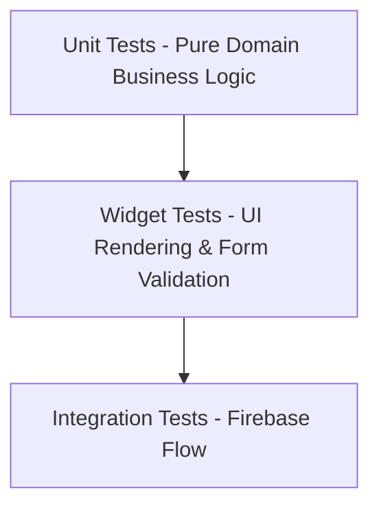

# Academic Architecture Guide: Credit Bill System

This guide provides in-depth technical explanations of the architectural decisions, design patterns, security rules, and testing strategies implemented in the Credit Bill System. It is designed to assist with project defense, code review, and academic presentation.

---

## 1. Architectural Paradigm: Clean Layered Feature-First

### Why Feature-First over Layer-First?
In traditional "Layer-First" Flutter projects, files are grouped by technical type:
```text
lib/
  ├── models/
  ├── screens/
  └── repositories/
```
As an application grows, developers must jump between distant directories for a single feature. In **Feature-First Architecture**, everything related to a single capability (like `cards` or `payments`) is co-located in its own feature folder:
```text
lib/features/cards/
  ├── data/           # Firestore mapping and repository implementation
  ├── domain/         # CardModel and repository contract
  └── presentation/   # UI widgets, AddCardScreen, and CardProvider
```
**Academic Benefits**:
* **High Cohesion & Low Coupling**: Changes to the `payments` logic never risk breaking the `auth` feature.
* **Separation of Concerns**: UI widgets only worry about rendering pixels; domain objects only contain pure Dart business logic; repositories only handle network/database communication.

---

## 2. State Management: Provider & ChangeNotifier

### Why Provider?
While modern Flutter offers several state management options (Riverpod, BLoC, MobX, GetX), **Provider** was selected for this project based on three academic criteria:
1. **Official Recommendation**: Provider is officially maintained and recommended in Google Flutter documentation.
2. **Readability & Zero Code Generation**: Unlike Riverpod (which often relies on `build_runner` for code-generation) or BLoC (which requires extensive boilerplate with separate Event, State, and Bloc classes), Provider uses standard Dart classes extending `ChangeNotifier`.
3. **Auditability**: Evaluators can easily trace how state transitions happen:
   * A user taps "Record Payment" $\to$ `PaymentProvider.addPayment()` is called.
   * The provider updates Firestore through the repository.
   * `notifyListeners()` is invoked $\to$ UI automatically rebuilds only the affected widgets.

---

## 3. Data Storage & Multi-Tenant Security

### Cloud Firestore Subcollections
Instead of flat root-level tables with foreign key columns, Firestore uses hierarchical document subcollections:
```text
/users (Collection)
   └── {userId} (Document)
         ├── /cards (Subcollection)
         │     └── {cardId}
         ├── /bills (Subcollection)
         │     └── {billId}
         └── /payments (Subcollection)
               └── {paymentId}
```

### Firestore Security Rules Explained
```javascript
rules_version = '2';
service cloud.firestore {
  match /databases/{database}/documents {
    // User root document and all child subcollections
    match /users/{userId}/{document=**} {
      allow read, write: if request.auth != null && request.auth.uid == userId;
    }
  }
}
```
**Why this is secure**:
* `request.auth != null`: Requires that the request comes from an authenticated Firebase user.
* `request.auth.uid == userId`: Guarantees that even if an attacker learns another user's document ID, Firestore's server-side engine rejects the query because their authenticated UID does not match the parent document ID.

---

## 4. Background Notification Architecture

### Handling Scheduled Reminders (`flutter_local_notifications`)
Mobile operating systems (especially Android 13+) impose strict battery-optimization restrictions on background services. To ensure 100% reliable due date reminders:
1. **Timezone Awareness**: The `timezone` package converts local bill dates into exact UTC timezone offsets, preventing alerts from firing at the wrong hour due to daylight saving or device travel.
2. **Deterministic ID Hash**: To allow the app to cancel pending alarms when a bill is paid, notification IDs are derived mathematically from the bill's unique ID:
   $$\text{Notification ID} = (\text{billId.hashCode} \ \& \ \text{0x7FFFFFFF}) \times 10 + \text{alertIndex}$$
3. **Clean Teardown**: When a bill is settled ($RemainingBalance == \$0.00$), the system queries these IDs and calls `cancel(id)`, preventing ghost alarms.

---

## 5. Software Testing Strategy

The project implements the classic **Testing Pyramid**:



### 1. Unit Testing (Domain Layer)
* Tests run in milliseconds without launching an Android emulator.
* Coverage includes:
  * `CreditCalculator.calculateUtilization(balances, limits)`: Tests boundary cases ($0$ limit, $<30\%$, $30-50\%$, $>50\%$).
  * `BillStatusEvaluator.evaluate(total, remaining, dueDate, currentDate)`: Tests transitions (`unpaid`, `partially_paid`, `paid`, `overdue`).
  * `ValidationUtils.validateLast4Digits("1234")`: Tests string bounds and numerical regex.

### 2. Widget Testing (Presentation Layer)
* Uses `mocktail` to inject mock repositories into providers.
* Verifies that when a card with limit $2,500 is provided, the Card Widget renders `"•••• 4812"` and `"$2,500.00"`.
* Verifies that tapping the submit button on an empty form triggers the inline error text.
